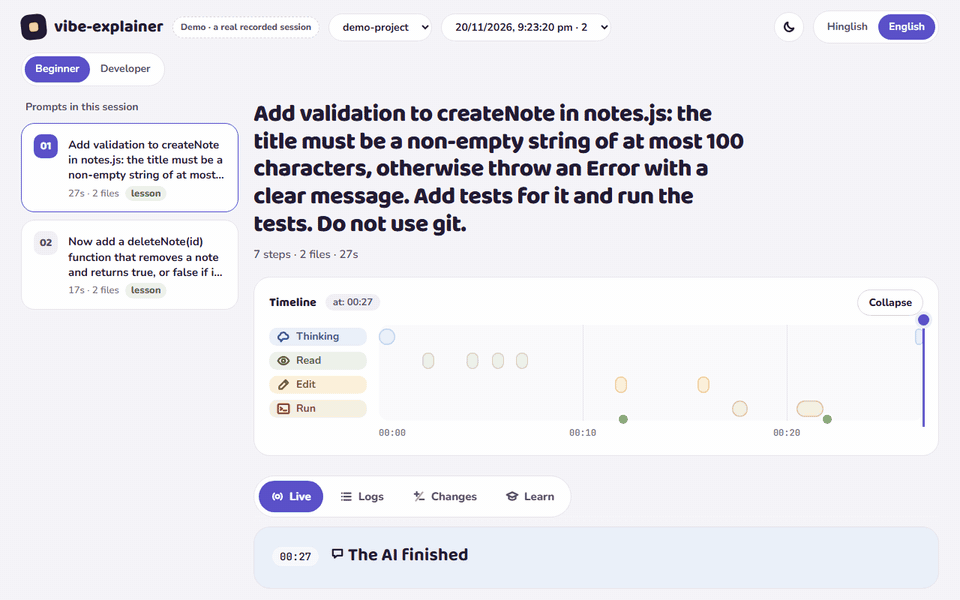

# vibe-explainer

**See what your AI coding agent did, explained like a teacher.**

You asked an AI agent to write code. It did. But what exactly did it change, why, what can
that break, and is "tests pass" actually true? vibe-explainer records every step the agent
takes and turns it into a lesson you can follow: a timeline, the diff in plain words, the
impact, a check of the agent's claims against the evidence, and a quiz, in Hinglish or English.

Everything runs on your machine. Your project's own `.git` is never written to. Nothing is
uploaded except to the teacher model. By default that is the same AI you code with, through its
own CLI and your own login (`claude`, `cursor-agent`, `codex` or `gemini`). In the console's ⚙ you can
pick your own model instead: Ollama (local and free), or Gemini / OpenAI / any OpenAI-style API with
a key that stays on your computer. One exception: when a
prompt adds a package, its name is looked up on the npm registry or PyPI for its licence and
size (`vibe-explainer config set registry off` turns that off).



**[Try the live demo →](https://ankitkumar9546.github.io/vibe-explainer/)** It's a real recorded
Claude Code session, with nothing to install. The demo data is in `demo/`, and the scripts that
built it are in `scripts/`.

> **Status: early development.** It works with Claude Code today. Roadmap: [docs/Roadmap.md](docs/Roadmap.md).
> The full planned console (guided lessons, playground, to-do) is in the [mockup](docs/mockup/console.html).

## Install (Claude Code plugin)

Inside Claude Code:

```
/plugin marketplace add ankitkumar9546/vibe-explainer
/plugin install vibe-explainer@vibe-explainer
```

Requirements: Node.js 22+ and git on your PATH. From then on every session in every project
is recorded under `~/.vibe-explainer/`.

| Command | What it does |
|---|---|
| `/vibe-explainer:explain` | Writes a lesson for your last finished prompt (about a minute, using your own Claude plan). Options: `--lang hi\|en`, `--level beg\|dev`, `--turn N` |
| `/vibe-explainer:console` | Opens the console in your browser: a live timeline, logs, the diff, the wiring map, the impact (who calls the code that changed), packages and security, and the lesson |

You can also just ask *"what did you change and is it safe?"*. The bundled skill answers from
the recorded evidence, not from memory. In the console, "Ask this session" does the same, and
you can click any line of the diff to ask what it does. The playground lets you change the AI's code
and run the project's own tests on a separate copy. Your files change only if you press Apply and
confirm.

## Without the plugin (CLI)

```bash
git clone https://github.com/ankitkumar9546/vibe-explainer && cd vibe-explainer
node packages/cli/bin/vibe-explainer.js init /path/to/project     # hooks for one project
node packages/cli/bin/vibe-explainer.js open /path/to/project     # the console
node packages/cli/bin/vibe-explainer.js analyze /path/to/project      # callers, packages, security notes
node packages/cli/bin/vibe-explainer.js explain /path/to/project --lang en
node packages/cli/bin/vibe-explainer.js export /path/to/project --kind pr   # or commit, note
node packages/cli/bin/vibe-explainer.js config set mode auto      # a lesson after every prompt
```

Use either the plugin or `init` in a project, not both, or every step is recorded twice.

**Ask from any MCP app:** the plugin also starts an MCP server, so in Claude Code you can ask *"what
changed yesterday?"* or *"what still needs checking?"*. For another MCP app (Claude Desktop, Cursor…),
add a server with the command `node /path/to/vibe-explainer/packages/mcp/bin/vibe-explainer-mcp.js`.

**Other agents (Cursor, Copilot, Aider…):** run `vibe-explainer watch /path/to/project --agent cursor` in a
terminal while the agent works. Each burst of edits becomes a prompt with a diff and a lesson. Type what you
asked the agent there to name it.
`init --remove` takes the project hooks out.

## How it works

Claude Code hooks feed a recorder, which writes to a local store. A shadow git repo snapshots
the code before and after each prompt. An analyzer reads both snapshots: which functions changed,
who calls them, which packages came or went, and risky patterns in the new lines. The teacher
(`claude -p`) writes the lesson from all of that, and a local console shows it.

[Architecture](docs/Architecture.md) · [Product](docs/PRD.md) · [Data format](docs/DataFormat.md) · [Design](docs/Design.md) · [Rules](docs/Rules.md)

## Development

```bash
npm install
npm test
claude --plugin-dir .      # try the plugin from this checkout without installing it
```

MIT licence. Node 22+. No native dependencies.
